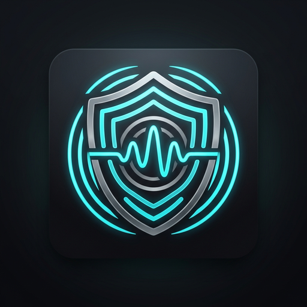

<div align="center">



# AcoustiGap

**Secure Acoustic Air-Gap Data Transmission System**  
*Truyền tải dữ liệu an toàn qua khoảng cách vật lý (Air-Gap) bằng sóng âm thanh giữa Máy tính Windows và Điện thoại Android (Tối ưu riêng cho Samsung Galaxy S24 Ultra).*

[](https://github.com/dudulingling/AcoustiGap/actions/workflows/android-release.yml)
[](https://github.com/dudulingling/AcoustiGap/actions/workflows/windows-release.yml)
[](LICENSE)
[](https://www.python.org/)
[](https://kotlinlang.org/)
[](https://developer.android.com/jetpack/compose)
[]()
[]()

[English](#english-overview) • [Tiếng Việt](#tổng-quan-tiếng-việt) • [Tải bản phát hành (Releases)](https://github.com/dudulingling/AcoustiGap/releases)

</div>

---

## 📌 Giới Thiệu (Overview)

**AcoustiGap** là giải pháp truyền tải thông điệp và tệp tin qua khoảng cách vật lý (Air-Gap) hoàn toàn bằng **sóng âm thanh**, kết nối hai chiều giữa **Máy tính Windows** (Dell, HP, ThinkPad...) và **Điện thoại Android** (Tối ưu đặc biệt cho **Samsung Galaxy S24 Ultra**).

### 🛡️ Nguyên tắc thiết kế cốt lõi
- **Không sử dụng thêm bất kỳ phần cứng ngoại vi nào:** Hoạt động 100% dựa trên loa ngoài và micro tích hợp sẵn của điện thoại và máy tính (hoặc cáp 3.5mm tiêu chuẩn nếu muốn truyền có dây chống nghe lén).
- **Chế độ Cận siêu âm (Near-Ultrasound):** Truyền tin hoàn toàn im lặng ở dải tần **15.5 kHz – 19.5 kHz**, tai người không thể nghe thấy nhưng micro máy tính và điện thoại vẫn thu nhận chính xác.
- **Bảo mật & Toàn vẹn tuyệt đối:** Mỗi khung truyền tin đều được bọc Header 15-byte, checksum **CRC-32 IEEE 802.3**, nén **zlib**, và mã băm toàn vẹn **SHA-256**.
- **Giao diện Modern Dark Mode:** Thiết kế tông đen tuyền (`#121212`) + xám khói sang trọng đồng bộ trên cả Windows (PySide6) và Android (Jetpack Compose AMOLED).

---

## 🏗️ Kiến Trúc Hệ Thống (System Architecture)

```mermaid
flowchart LR
    subgraph PC["🖥️ Windows PC (AcoustiGap.exe)"]
        W_UI["Dark Mode Desktop GUI\n(Real-Time 30 FPS Waterfall)"]
        W_PROTO["15-Byte Frame & Chunker\n(CRC32 + zlib + SHA-256)"]
        W_DSP["48 kHz FSK Engine\n(Normal / Fast / Ultrasound)"]
        W_AUDIO["PortAudio / WASAPI Streams\n(Mic Array & Stereo Speakers)"]
        W_UI --> W_PROTO --> W_DSP --> W_AUDIO
    end

    subgraph AIR["🔊 ACOUSTIC AIR-GAP CHANNEL (0.1m - 2.0m)"]
        WAVE_A["Audible FSK (1.8 - 4.5 kHz)"]
        WAVE_U["Silent Ultrasound (15.5 - 19.5 kHz)"]
    end

    subgraph PHONE["📱 Samsung Galaxy S24 Ultra (Android Client)"]
        A_AUDIO["UNPROCESSED Mic Capture\n(Bypass One UI Voice Focus)"]
        A_DSP["Native Kotlin DSP\n(48 kHz Tone Synthesizer & FFT)"]
        A_PROTO["Reassembly & Base85 Engine\n(CRC32 & SHA-256 Verifier)"]
        A_UI["AMOLED Pure Dark UI\n(Sender / Receiver / Diagnostics)"]
        A_AUDIO --> A_DSP --> A_PROTO --> A_UI
    end

    W_AUDIO <==> WAVE_A & WAVE_U <==> A_AUDIO
```



---

## 📱 Điểm Tối Ưu Cho Samsung Galaxy S24 Ultra

Samsung Galaxy S24 Ultra trang bị vi xử lý **Snapdragon 8 Gen 3 for Galaxy**, hệ thống 3 micro định hướng và loa stereo AKG. AcoustiGap khai thác tối đa phần cứng này:

1. **Bypass bộ lọc âm thanh One UI (`AudioSource.UNPROCESSED`):**
   - Trên One UI 6.1+, API ghi âm thông thường kích hoạt tính năng *Voice Focus* và *Beamforming*, vốn sẽ cắt gọt toàn bộ dải tần số trên 10 kHz.
   - AcoustiGap sử dụng nguồn `UNPROCESSED`, cho phép thu dải tần rộng từ **20 Hz đến 22,000+ Hz** ở tần số mẫu **48,000 Hz**, bắt trọn các sóng siêu âm FSK yếu nhất.
2. **Loa Stereo AKG Dynamic Range:**
   - Điều biến FSK trực tiếp qua `AudioTrack` 16-bit 48 kHz với cửa sổ làm mịn Raised-Cosine, ngăn ngừa xung kích điện (audio pop/click) và méo hài bậc cao.
3. **Màn hình Dynamic AMOLED 2X:**
   - Giao diện Pure Black (`#121212`) tiết kiệm pin tối đa và hiển thị phổ âm thanh Waterfall thời gian thực mượt mà.

---

## ⚡ Báo Cáo Thử Nghiệm Tự Động (Benchmark Results)

Hệ thống đã trải qua quy trình kiểm thử tự động toàn diện:
- **DSP Core Loopback:**
  - `NORMAL` (Audible): 6.83 s (7.2 B/s) — **PASS**
  - `FAST` (Audible): 4.78 s (10.3 B/s) — **PASS**
  - `FASTEST` (Audible): 2.73 s (17.9 B/s) — **PASS**
  - `ULTRASOUND_FAST` (Near-Ultrasound): 4.78 s (10.3 B/s) — **PASS**
- **Sàn nhiễu phòng (Dell G5 Laptop Mic):**
  - RMS Noise Floor: **-33.93 dBFS** (Đạt chuẩn *ACCEPTABLE* cho phòng làm việc bình thường).
- **Unit & Integration Test Suite:**
  - 13/13 test cases passed (**100% PASS** in 0.27s).

---

## 🚀 Hướng Dẫn Cài Đặt & Sử Dụng

### 1. Dành cho Windows

#### Cách A: Chạy trực tiếp file Executable (.exe) — Khuyên Dùng
Tải bản phát hành từ mục [Releases](https://github.com/dudulingling/AcoustiGap/releases):
1. Tải file `AcoustiGap-Windows-x64.zip`.
2. Giải nén vào thư mục bất kỳ.
3. Nhấp đúp vào `AcoustiGap.exe` để mở giao diện Dark Mode (không cần cài đặt Python, không hiện màn hình đen console).

#### Cách B: Chạy từ mã nguồn Python
```bash
# Clone repository
git clone https://github.com/dudulingling/AcoustiGap.git
cd AcoustiGap

# Cài đặt thư viện phụ thuộc
pip install -r requirements.txt

# Mở giao diện Desktop GUI
python run_acoustigap.py
```

#### Sử dụng qua Command Line (CLI):
```bash
# Liệt kê thiết bị micro & loa
python -m acoustigap.cli.main devices

# Đo độ ồn phòng (Noise Floor)
python -m acoustigap.cli.main noise-floor -t 2.0

# Gửi tin nhắn cận siêu âm (hoàn toàn im lặng)
python -m acoustigap.cli.main send-text "Secret Message" --protocol ULTRASOUND_FAST --volume 70

# Lắng nghe tin nhắn trên microphone
python -m acoustigap.cli.main listen-text

# Truyền file qua sóng âm
python -m acoustigap.cli.main send-file ./document.pdf --protocol ULTRASOUND_FAST

# Nhận file qua sóng âm
python -m acoustigap.cli.main receive-file -o ./received_files
```

---

### 2. Dành cho Android (Samsung S24 Ultra)

#### Cách A: Cài đặt file APK tải sẵn
1. Truy cập mục [Releases](https://github.com/dudulingling/AcoustiGap/releases) hoặc tab **Actions** trên GitHub.
2. Tải file `AcoustiGap-v1.0.0-Android.apk` về điện thoại Samsung S24 Ultra.
3. Nhấp vào file để cài đặt (cho phép cài từ nguồn này nếu được hỏi).

#### Cách B: Mở và Build bằng Android Studio
1. Mở **Android Studio**.
2. Chọn **Open** -> Chọn thư mục `android/`.
3. Chờ Gradle đồng bộ tự động.
4. Kết nối điện thoại và bấm nút **Run ▶**.

---

## 📡 Định Dạng Gói Tin (Wire Protocol Specification)

Mỗi khung truyền dữ liệu gồm Header cố định **15 bytes** (Big-Endian):

| Offset | Kích thước | Trường | Kiểu dữ liệu | Mô tả |
|:---:|:---:|:---|:---:|:---|
| `0x00` | 2 bytes | **Magic Header** | `0xAC, 0x61` | Ký hiệu nhận dạng khung AcoustiGap |
| `0x02` | 1 byte | **Protocol Version** | `0x01` | Phiên bản giao thức |
| `0x03` | 1 byte | **Packet Type** | `uint8` | `1`: START, `2`: DATA, `3`: END, `4`: ACK, `5`: NACK |
| `0x04` | 2 bytes | **Session ID** | `uint16` | Mã phiên truyền tải |
| `0x06` | 2 bytes | **Chunk Index** | `uint16` | Thứ tự mảnh dữ liệu (0-indexed) |
| `0x08` | 2 bytes | **Total Chunks** | `uint16` | Tổng số mảnh dữ liệu |
| `0x0A` | 1 byte | **Payload Length** | `uint8` | Chiều dài phần thân dữ liệu (0 – 255) |
| `0x0B` | 4 bytes | **CRC-32 Checksum** | `uint32` | Mã kiểm tra lỗi IEEE 802.3 tính trên (Header pre-CRC + Payload) |
| `0x0F` | N bytes | **Payload** | `bytes` | Dữ liệu nhị phân hoặc chuỗi Base85 |

---

## 📁 Cấu Trúc Thư Mục Dự Án (Repository Structure)

```text
AcoustiGap/
├── .github/
│   └── workflows/
│       ├── android-release.yml    # Tự động build Release APK trên GitHub Actions
│       └── windows-release.yml    # Tự động build Windows Executable trên GitHub Actions
├── acoustigap/                    # Core Python Package (Transceiver)
│   ├── cli/                       # Giao diện dòng lệnh Click CLI
│   ├── core/                      # DSP Engine, điều chế FSK 48kHz
│   ├── gui/                       # PySide6 Dark Mode Desktop Console & Waterfall
│   ├── hardware/                  # Quản lý thiết bị PortAudio & đo sàn nhiễu
│   └── protocol/                  # Khung gói tin 15-byte, Chunker, Session
├── android/                       # Ứng dụng Android Native (Kotlin + Compose)
│   ├── app/src/main/              # UI screens, AudioCapture, DSP, Mipmap Icons
│   └── README.md                  # Hướng dẫn chi tiết cho Samsung S24 Ultra
├── assets/                        # Bộ nhận diện icon Windows & Android
│   ├── icon.ico                   # Windows multi-resolution icon
│   ├── icon.png                   # Logo gốc 512x512
│   └── android/                   # Mipmap densities (MDPI -> XXXHDPI)
├── scripts/                       # Kịch bản tự động hóa
│   ├── build_windows_exe.py       # Đóng gói Windows .exe & release ZIP
│   └── run_tests.py               # Chạy toàn bộ test suites
├── tests/                         # Bộ kiểm thử đơn vị & tích hợp (13 tests)
├── AcoustiGap.spec                # PyInstaller specification file
├── LICENSE                        # Giấy phép MIT
├── README.md                      # Tài liệu dự án
└── requirements.txt               # Thư viện phụ thuộc Python
```

---

## 📄 Bản Quyền (License)

Dự án được phân phối dưới giấy phép **[MIT License](LICENSE)**. Toàn bộ mã nguồn mở tự do cho mục đích nghiên cứu, học tập và triển khai bảo mật Air-Gap.
